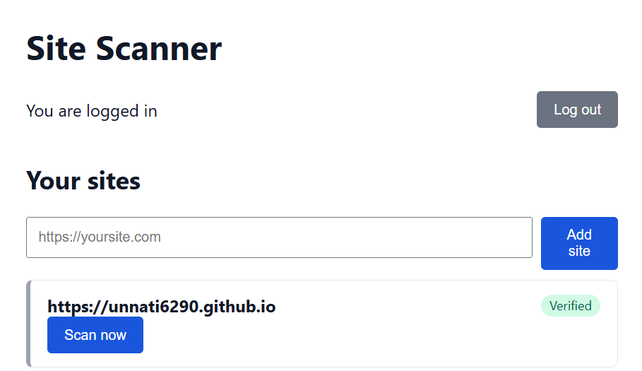

# Site Scanner

A Node.js/Express web app that scans websites for common security
misconfigurations and reports each issue with a severity rating and a fix.
Users must prove they own a site before it can be scanned.

## Screenshots




## Features
- Security header checks (HSTS, CSP, X-Frame-Options, and more)
- Cookie flag checks (HttpOnly, Secure, SameSite)
- Exposed sensitive file checks (.env, .git)
- User accounts with JWT authentication
- Site ownership verification (file or DNS TXT record)
- Saved scan history per user

## Security design
- Passwords hashed with bcrypt; JWT authentication
- Rate limiting and Helmet on the API itself
- Site ownership verification before any scan
- SSRF protection: blocks private/internal IPs and re-checks every redirect
- Per-user data isolation (scans and sites are scoped to the owner)
- Frontend renders all data with textContent, never innerHTML

## Known limitations
- Does not defend against DNS rebinding
- Passive checks only; no active exploitation
- Auth token is stored in localStorage

## Tech stack
Node.js, Express, MongoDB (Mongoose), JWT, bcrypt, vanilla JavaScript frontend

## Run locally
1. Clone the repo and run `npm install`
2. Create a `.env` file:
```
   PORT=3000
   MONGO_URI=your-mongodb-connection-string
   JWT_SECRET=a-long-random-string
```
3. Run `npm run dev` and open http://localhost:3000

## Run tests
```
npm test
```

## API
- `POST /api/auth/register`, `POST /api/auth/login`
- `POST /api/sites`, `GET /api/sites`, `POST /api/sites/:id/verify`
- `POST /api/scan`, `GET /api/scan`, `GET /api/scan/:id`

## Disclaimer
Only scan websites you own or have permission to test.